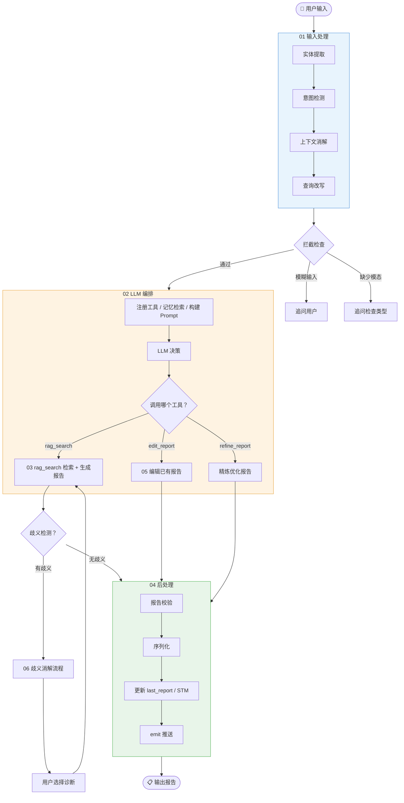

**总览：报告生成管线全流程**

## 总览说明

| 编号 | 文件                         | 类型   | 内容                                                     |
| ---- | ---------------------------- | ------ | -------------------------------------------------------- |
| 01   | `01_phase1_input.md`         | 序列图 | 输入处理：实体提取 → 意图检测 → 上下文消解 → 查询改写    |
| 02   | `02_llm_orchestration.md`    | 序列图 | LLM 编排：工具注册 → 记忆检索 → Prompt 构建 → LLM 决策   |
| 03   | `03_rag_search_internal.md`  | 序列图 | rag_search 内部：查询规划 → 混合检索 → Rerank → 生成报告 |
| 04   | `04_phase3_postprocess.md`   | 序列图 | 后处理：报告校验 → 序列化 → 状态更新 → 推送              |
| 05   | `05_edit_report.md`          | 序列图 | 编辑报告：LLM 编辑 + 医学事实保护校验                    |
| 06   | `06_ambiguity_resolution.md` | 序列图 | 歧义消解：两轮交互时序                                   |
