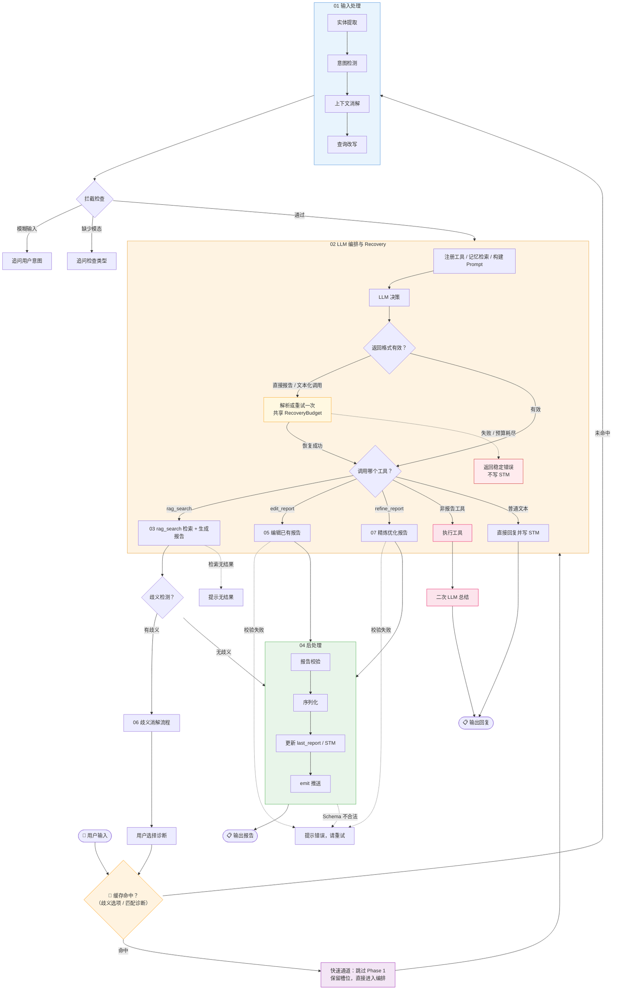

**总览：报告生成管线全流程**

## 总览说明

| 编号 | 文件                            | 类型   | 内容                                                     |
| ---- | ------------------------------- | ------ | -------------------------------------------------------- |
| 01   | `01_phase1_input.md`            | 序列图 | 输入处理：实体提取 → 意图检测 → 上下文消解 → 查询改写    |
| 02   | `02_phase2_orchestration.md`    | 序列图 | LLM 编排：工具注册 → 决策/格式恢复 → 工具执行/终态分流   |
| 03   | `03_phase2.1_rag_search.md`     | 序列图 | rag_search 内部：查询规划 → 混合检索 → Rerank → 生成报告 |
| 04   | `04_phase3_postprocess.md`      | 序列图 | 后处理：报告校验 → 序列化 → 状态更新 → 推送              |
| 05   | `05_phase2.2_edit_report.md`    | 序列图 | 编辑报告：LLM 编辑 + 三级校验 + 事实保护 + 修复          |
| 06   | `06_ambiguity_resolution.md`    | 序列图 | 歧义消解：两轮交互时序                                   |
| 07   | `07_phase2.3_refine_report.md`  | 序列图 | 精炼报告：LLM 重写 + 风格调整 + 事实保护                 |
| 08   | `08_data_pipeline.md`           | 序列图 | 离线数据管线：Excel → Markdown → 向量库 → 元数据树       |
| 09   | `09_eval_pipeline.md`           | 序列图 | 评测管线：用例管理 → 流式评测 → Hit@K 指标               |
| 10   | `10_memory_architecture.md`     | 序列图 | 记忆系统：EntityTracker / STM / SessionStore / Retriever |
| 11   | `11_deployment_architecture.md` | 序列图 | 部署架构：Gateway (8000) → Worker (8001) 两层拓扑        |

## 关键路径说明

### 🎯 缓存命中 & 快速通道

用户输入首先经过**缓存命中检查**：如果输入文本匹配上一轮歧义消解中缓存的诊断名称（精确匹配或包含关系），则直接命中，**跳过整个 Phase 1（实体提取/意图检测/上下文消解/查询改写）**，保留上一轮的 modality/body_part 槽位，直接进入 Phase 2 LLM 编排。

触发场景：

- 歧义消解后用户点击/输入了某个诊断名称（如"肝囊肿"）
- 用户输入与缓存诊断完全匹配或包含关系

### 🔧 非报告工具 → 二次 LLM 调用

当 LLM 选择调用**非报告工具**（非 rag_search/edit_report/refine_report）时，工具执行后不会直接返回，而是再调用一次 LLM 对工具结果进行总结，生成自然语言回复。报告工具（rag_search/edit_report/refine_report）则标记 `is_final=true`，直接进入后处理，**跳过二次 LLM 调用**以避免引入幻觉。

### ⚠️ 错误降级路径（虚线）

- **检索无结果**：rag_search 返回"未检索到相关报告"，不进入歧义检测
- **报告校验失败**：工具内部失败先按错误码分类；仅白名单错误可共享预算重跑一次，terminal 错误直接结束
- **模型格式异常**：模型直接返回合法报告 JSON 时要求改走 Report Tool；文本化工具调用优先解析，解析失败才重试

### 🔄 Recovery 错误自恢复（新增）

Pipeline 内置**错误自恢复机制**，在 LLM 偶发行为异常时自动恢复：

| 场景                                           | 代码行为                                                        | 失败/耗尽后             |
| ---------------------------------------------- | --------------------------------------------------------------- | ----------------------- |
| Main LLM 绕过工具直接输出合法报告             | 追加提示，要求选择 Report Tool，重试 1 次                        | “本次报告处理未能完成”  |
| Main LLM 输出文本化工具调用                    | 先解析 JSON/函数格式；解析失败时提示使用 function calling 并重试 | “服务暂时不可用”        |
| Main LLM 同时选择多个报告工具                  | 全部执行后按 rag_search > edit_report > refine_report 选择终态   | 不额外消耗恢复预算      |
| Optional Final LLM 输出文本化工具调用          | 追加普通文本约束并重试 1 次                                     | “操作完成，请查看结果”  |

**工具错误分类**：

- **用户可处理**（`NO_LAST_REPORT` / `LLM_SERVICE_ERROR`）→ 直接返回用户，写入 STM，不重试
- **可恢复**（`REPORT_PARSE_FAILED` / `EDIT_JUDGE_FAILED`）→ 白名单内，retry 1 次
- **terminal**（`UNKNOWN_TOOL_ERROR` / `EDIT_REPAIR_FAILED` / `REPORT_SCHEMA_INVALID`）→ 不重试，禁止再次进入 Main LLM

**关键约束**：内部错误不写入 STM，避免污染后续多轮记忆。恢复预算在每次顶层 Pipeline 调用创建，递归恢复沿用同一个预算。多报告工具仲裁发生在工具全部执行后，只选择终态结果，不撤销其他工具执行。
