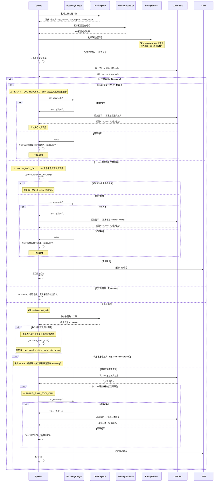

**Phase 2 — LLM 编排决策（工具注册 → 记忆检索 → Prompt 构建 → 决策与调度 + Recovery）**

## Recovery 机制说明

Pipeline 内置**错误自恢复机制**，在 LLM 偶发行为异常时自动恢复，避免直接暴露内部错误给用户。

| 场景                                  | 触发条件                                            | 恢复策略                                                       | 预算耗尽后                            |
| ------------------------------------- | --------------------------------------------------- | -------------------------------------------------------------- | ------------------------------------- |
| Report Tool required                  | LLM 在 content 中直接返回合法报告，未走 tool_calls  | 追加提示要求选择工具，重试 1 次                                | “本次报告处理未能完成，请稍后再试。”  |
| Invalid textual tool call             | LLM 在文本中序列化工具调用（如 `<tool_call>`）      | 先解析 JSON/函数格式；解析失败才追加 function calling 提示重试 | “服务暂时不可用，请稍后重试。”        |
| Multiple report tools                 | LLM 同时调用多个报告工具                            | 全部执行后按 rag_search > edit_report > refine_report 选择终态 | —                                     |
| Invalid optional-final tool call      | 非报告工具的二次 LLM 输出序列化工具调用             | 追加提示要求普通文本，重试 1 次                                | 兜底“操作完成，请查看结果。”          |

**关键约束**：

- 顶层 `run_pipeline()` 创建 `RecoveryBudget(max_attempts=1)`；递归恢复显式传入同一实例，不跨用户轮次污染
- Main LLM 格式恢复、可恢复报告工具错误和 Optional Final 格式恢复共享这一次预算
- 内部错误（`RECOVERY_FAILED` / `RECOVERY_EXHAUSTED` / `UNKNOWN_TOOL_ERROR`）**不写入 STM**，避免污染后续多轮记忆
- 用户可处理的业务错误（`NO_LAST_REPORT` / `LLM_SERVICE_ERROR`）直接返回并写入 STM
