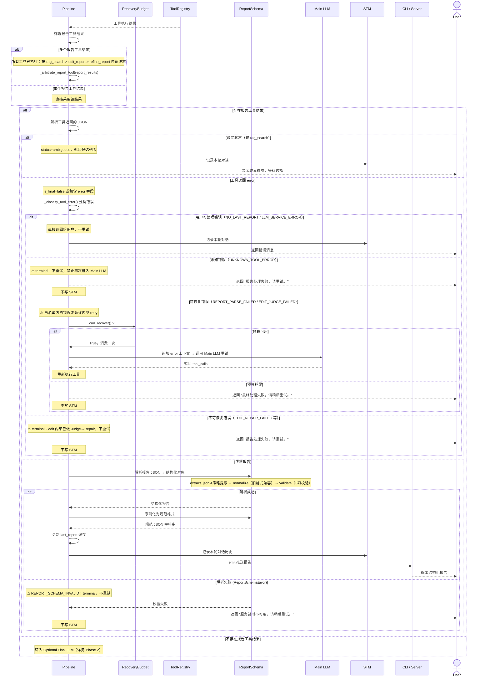

**Phase 3 — 后处理（校验 → 序列化 → 状态更新 → 推送）**

## 错误分类与 Recovery

| 错误码                  | 分类         | 行为                                         | 写 STM        |
| ----------------------- | ------------ | -------------------------------------------- | ------------- |
| `NO_LAST_REPORT`        | 用户可处理   | 直接返回给用户，提示"没有可编辑的报告"       | ✅            |
| `LLM_SERVICE_ERROR`     | 用户可处理   | 直接返回给用户，提示"LLM 服务异常"           | ✅            |
| `REPORT_PARSE_FAILED`   | 可恢复       | Pipeline 内部 retry 一次，调用 Main LLM 重试 | ❌ 仅成功时写 |
| `EDIT_JUDGE_FAILED`     | 可恢复       | Pipeline 内部 retry 一次，调用 Main LLM 重试 | ❌ 仅成功时写 |
| `EDIT_REPAIR_FAILED`    | **terminal** | edit 内部已完成 Judge→Repair 仍失败，不重试  | ❌            |
| `UNKNOWN_TOOL_ERROR`    | **terminal** | 不重试，禁止再次进入 Main LLM                | ❌            |
| `REPORT_SCHEMA_INVALID` | **terminal** | Schema 校验失败，不重试                      | ❌            |

**关键约束**：

- 可恢复错误白名单：`_RECOVERABLE_REPORT_ERRORS = {"REPORT_PARSE_FAILED", "EDIT_JUDGE_FAILED"}`
- `EDIT_REPAIR_FAILED` 不在白名单：edit_report 内部已消耗一次 Judge→Repair 预算，Pipeline 不应再重试
- 所有 terminal 错误和 recovery 耗尽错误**不写入 STM**，避免污染后续多轮记忆
- 恢复预算 `RecoveryBudget(max_attempts=1)`，每次 pipeline 调用独立
