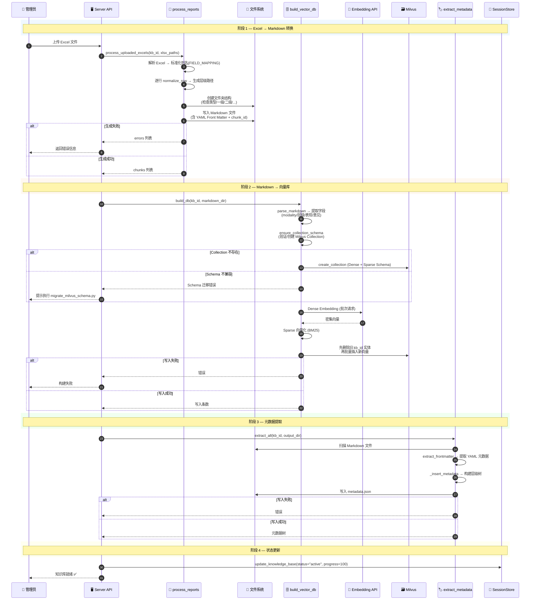
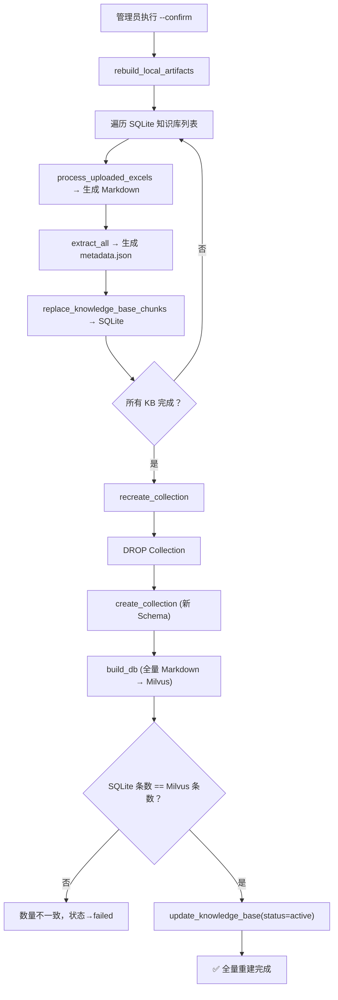

**Data Pipeline — 离线数据管线（Excel → Markdown → 向量库 → 元数据树）**



---

**参与组件**

| 组件 | 职责 |
|------|------|
| `process_reports.py` | Excel 解析 → 层级文件夹 → Markdown（含 Front Matter） |
| `build_vector_db.py` | Markdown 解析 → Dense+Sparse 向量化 → Milvus 写入 |
| `extract_metadata.py` | 扫描 Markdown Front Matter → 构建层级元数据树 → `metadata.json` |
| `chunk_id.py` | 三端统一的 chunk_id 生成（MD5） |
| `rebuild_all_knowledge_bases.py` | 全量重建编排：Markdown + SQLite chunks + Milvus |
| `migrate_milvus_schema.py` | Milvus Schema 检查与迁移工具 |

---

**全量重建流程（rebuild_all_knowledge_bases.py）**



---

**Schema 字段（Milvus Collection）**

| 字段 | 类型 | 用途 |
|------|------|------|
| `kb_id` | VARCHAR(64) | 知识库标识 |
| `chunk_id` | VARCHAR(32) | 三端统一 MD5 标识 |
| `modality` | VARCHAR(32) | 检查类型（CT/MR/...） |
| `level_1~4` | VARCHAR(64) | 层级目录 |
| `module_name` | VARCHAR(128) | 模块名称 |
| `imaging_findings` | VARCHAR(4096) | 影像学表现 |
| `imaging_opinion` | VARCHAR(4096) | 影像学意见 |
| `combined_text` | VARCHAR(8192) | 组合文本（检索用） |
| `dense_vector` | FLOAT_VECTOR | 密集向量（语义检索） |
| `sparse_vector` | SPARSE_FLOAT_VECTOR | 稀疏向量（关键词检索） |

---

**与运行时管线的衔接**

```
Data Pipeline 产出           →  运行时管线消费
─────────────────────────────────────────────────
Milvus 向量库                →  rag/retrieval.py 检索
metadata.json                →  rag/metadata_navigator.py 导航
                           →  rag/query_planner.py 查询规划
                           →  memory/ 生成实体配置
Markdown 文件                →  build_vector_db.py 增量构建
SQLite chunks               →  memory/session_store.py 管理
```