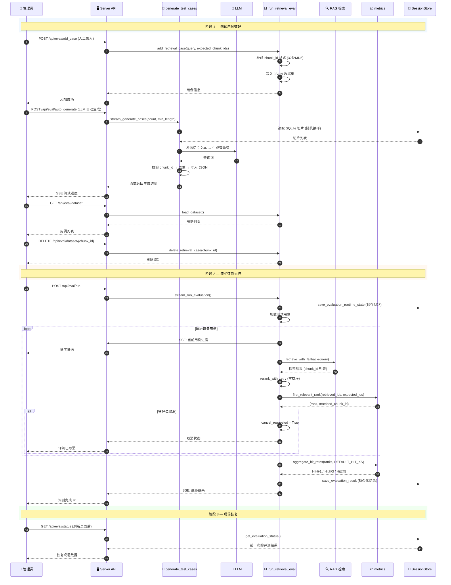

**Eval Pipeline — 评测管线（用例管理 → 流式评测 → Hit@K 指标）**

---

**参与组件**

| 组件 | 职责 |
|------|------|
| `run_retrieval_eval.py` | 评测引擎：流式执行、用例 CRUD、取消、现场恢复 |
| `generate_test_cases.py` | LLM 自动生成测试用例（SQLite 切片抽样 → LLM 生成 Query） |
| `metrics.py` | Hit@K 指标计算：`first_relevant_rank`, `aggregate_hit_rates` |
| `datasets/retrieval_test_cases.json` | 测试用例数据集（JSON 数组） |

---

**关键设计**

| 机制 | 说明 |
|------|------|
| 流式 SSE | 评测进度通过 SSE 实时推送到浏览器 |
| 现场恢复 | 评测状态通过 SQLite 持久化，刷新页面不丢数据 |
| 协作取消 | `cancel_requested` 标志位，下一轮循环检查 |
| 单任务锁 | `evaluation_lock` 保证同时只有一个评测运行 |
| 三端对齐 | 测试用例的 chunk_id 必须与 data_pipeline 的 `generate_chunk_id` 一致 |