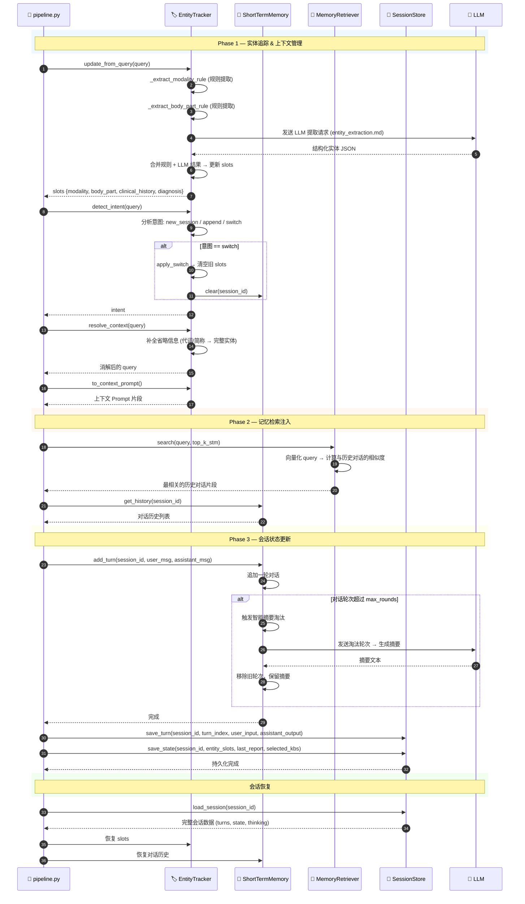
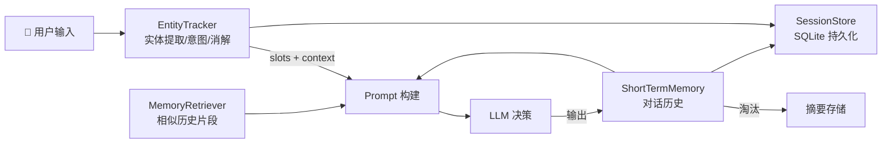

**Memory Architecture — 记忆系统架构（实体追踪 / 短期记忆 / 持久化 / 检索注入）**



---

**四组件职责**

| 组件 | 一句话定位 | 关键方法 |
|------|-----------|----------|
| **EntityTracker** | 管理医学实体槽位，驱动输入处理 | `update_from_query`, `detect_intent`, `resolve_context`, `to_context_prompt` |
| **ShortTermMemory** | 内存对话历史，智能摘要淘汰 | `add_turn`, `get_history`, `get_summaries`, `clear` |
| **SessionStore** | SQLite 持久化，会话/KB/Deployment 管理 | `create_session`, `save_turn`, `save_state`, `load_session` |
| **MemoryRetriever** | 语义相似度检索历史对话片段 | `index_stm`, `search` |

---

**数据流转图**



---

**智能摘要淘汰机制**

```
对话轮次 > max_rounds
    ↓
选取最早的 N 轮对话
    ↓
LLM 生成摘要 (summarize.md)
    ↓
移除旧轮次，保留摘要
    ↓
后续对话注入摘要 + 最近轮次
```

---

**与 AGENTS.md 的一致性**

- `memory/AGENTS.md` 的 Entry Points 顺序与本 UML 一致：`session_store → entity_tracker → short_term → retriever`
- switch 意图的规则：只有带明确切换表达 + 检查类型/部位/目标的输入才清状态；"改成数值、修改报告、润色"等报告操作不触发 switch