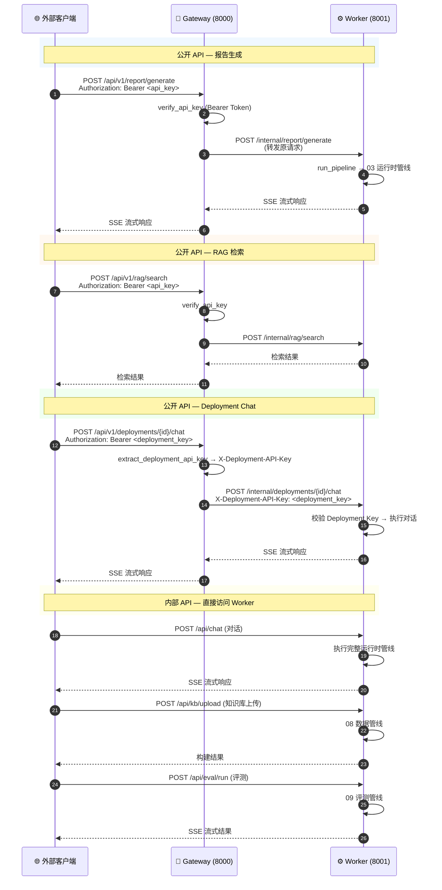
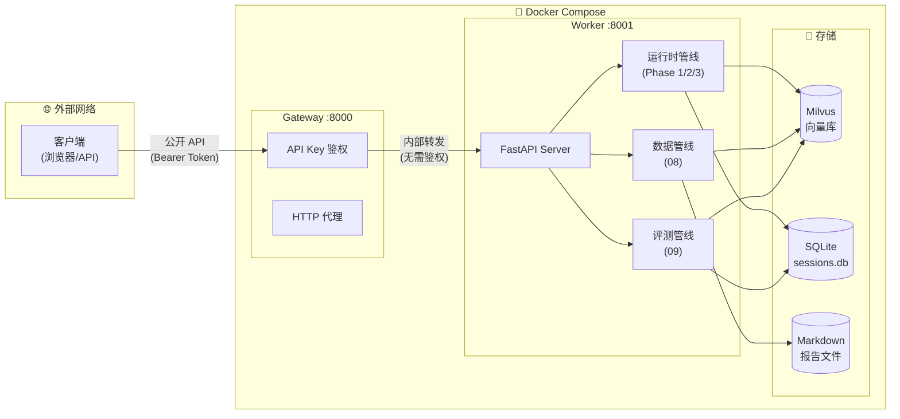

**Deployment Architecture — 部署架构（Gateway → Worker 拓扑）**

---

**拓扑结构**

---

**Gateway 职责**

| 职责 | 说明 |
|------|------|
| 鉴权 | `verify_api_key` — 验证 Bearer Token |
| 代理 | 转发请求到 Worker，透传 SSE 流式响应 |
| 隔离 | Gateway 不导入任何 Worker 代码（模型/向量库等），纯 HTTP 代理 |
| Deployment 鉴权 | `extract_deployment_api_key` — 提取 Deployment Key 通过内部 Header 传给 Worker |

**Worker 路由**

| 路由前缀 | 用途 |
|----------|------|
| `/internal/*` | Gateway 转发的内部请求（无需鉴权） |
| `/api/chat` | 对话（直接访问） |
| `/api/kb/*` | 知识库管理 |
| `/api/eval/*` | 评测 |
| `/api/deployments/*` | Deployment 管理 |
| `/api/session/*` | 会话管理 |
| `/api/config` | 配置管理 |

---

**关键设计**

| 机制 | 说明 |
|------|------|
| 双层鉴权 | Gateway 验证 API Key（公开），Worker 内部路由无需鉴权 |
| Deployment 隔离 | 每个 Deployment 有独立 Key，通过 `X-Deployment-API-Key` Header 传递 |
| 流式透传 | Gateway 使用 `httpx.AsyncClient` 流式转发 SSE，不缓冲完整响应 |
| 超时保护 | Worker 请求超时 600s，Gateway 返回 504 |
| 独立部署 | Gateway 和 Worker 是两个独立进程，通过 Docker Compose 编排 |